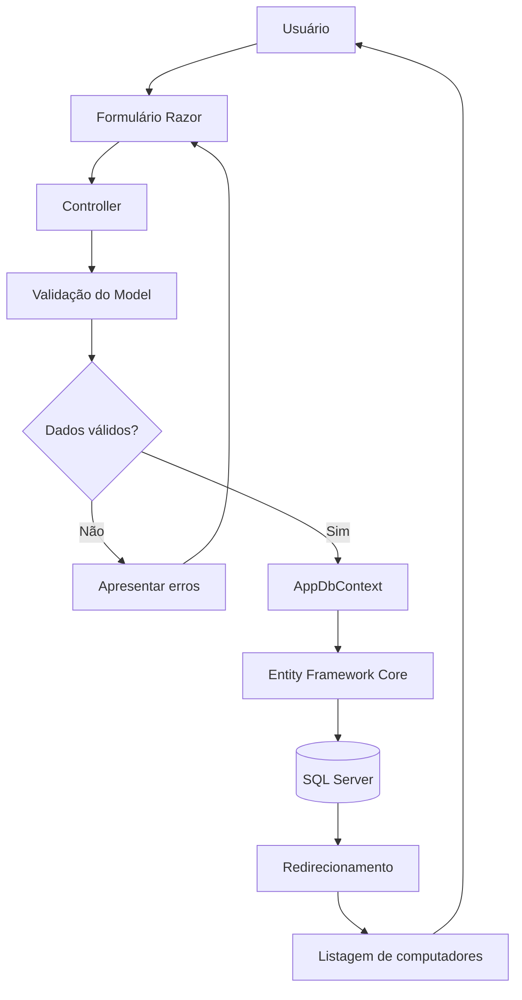

# 💻 Cadastro de Computadores — ASP.NET Core MVC


## 📖 Sobre o projeto

O **Cadastro de Computadores** é uma aplicação web desenvolvida com ASP.NET Core MVC, destinada ao cadastro, à consulta e ao gerenciamento inicial de informações sobre computadores.

O projeto foi desenvolvido com finalidade educacional, buscando demonstrar, na prática, a integração entre front-end, back-end e banco de dados relacional, utilizando a arquitetura MVC (Model-View-Controller).

A aplicação permite cadastrar equipamentos, validar informações e armazenar os registros permanentemente em um banco de dados SQL Server.

## 🎯 Objetivos

- Compreender a arquitetura MVC.
- Desenvolver aplicações web utilizando C# e ASP.NET Core.
- Integrar HTML, CSS e Razor ao back-end.
- Trabalhar com formulários e validação de dados.
- Utilizar o Entity Framework Core para persistência de informações.
- Integrar aplicações web com SQL Server.
- Aplicar conceitos de programação orientada a objetos.
- Utilizar Git e GitHub para versionamento de código.

## 🚀 Funcionalidades

- [x] Cadastro de computadores.
- [x] Listagem dos computadores cadastrados.
- [x] Validação de campos obrigatórios.
- [x] Validação de valores numéricos.
- [x] Armazenamento de dados no SQL Server.
- [x] Geração automática de identificadores.
- [x] Mensagem de confirmação de cadastro.
- [x] Interface personalizada com CSS.

## 🛠️ Tecnologias utilizadas

| Tecnologia | Finalidade |
|---|---|
| C# | Linguagem de programação back-end |
| .NET 10 | Plataforma de desenvolvimento |
| ASP.NET Core MVC | Framework de desenvolvimento web |
| Entity Framework Core 10 | Mapeamento objeto-relacional (ORM) |
| SQL Server | Banco de dados relacional |
| HTML5 | Estrutura das páginas |
| CSS3 | Estilização da interface |
| Razor | Integração entre HTML e C# |
| Visual Studio 2026 | Ambiente de desenvolvimento |
| Git | Controle de versões |
| GitHub | Hospedagem do código-fonte |

O projeto não depende de Bootstrap, jQuery ou bibliotecas JavaScript externas.

## 🏗️ Arquitetura MVC

A aplicação utiliza o padrão arquitetural MVC, que separa as responsabilidades do sistema em três componentes principais:

### Model

Responsável pela representação dos dados e pelas regras de validação.

A classe `Computador.cs` representa os equipamentos cadastrados no sistema.

### View

Responsável pela interface apresentada ao usuário.

Utiliza HTML, CSS e Razor para construir os formulários e apresentar os registros.

### Controller

Responsável por receber as requisições HTTP, processar as informações e coordenar as operações entre o Model, as Views e o acesso ao banco de dados.

### Camada de acesso aos dados

A classe `AppDbContext.cs` utiliza o Entity Framework Core para realizar a comunicação entre a aplicação e o SQL Server.

## 🔄 Fluxo de funcionamento



## 📁 Estrutura do projeto

```text
ComputadoresMvc/
├── Controllers/
│   └── ComputadoresController.cs
├── Models/
│   └── Computador.cs
├── Data/
│   └── AppDbContext.cs
├── Database/
│   └── criar-banco.sql
├── Views/
│   ├── Computadores/
│   │   ├── Criar.cshtml
│   │   └── Index.cshtml
│   ├── Shared/
│   │   └── _Layout.cshtml
│   ├── _ViewImports.cshtml
│   └── _ViewStart.cshtml
├── Properties/
│   └── launchSettings.json
├── wwwroot/
│   └── css/
│       └── site.css
├── appsettings.json
├── Program.cs
├── ComputadoresMvc.csproj
├── .gitignore
└── README.md
```

## 🗄️ Banco de dados

A aplicação utiliza o SQL Server para armazenar os computadores cadastrados.

**Banco de dados:** `CadastroComputadores`

**Tabela:** `dbo.Computadores`

### Informações armazenadas

| Campo | Descrição |
|---|---|
| ID | Identificador único do computador |
| Nome | Nome ou identificação do equipamento |
| Marca | Fabricante do computador |
| Processador | Modelo do processador |
| Memória RAM | Capacidade de memória em GB |
| Armazenamento | Capacidade de armazenamento em GB |

O identificador é gerado automaticamente pelo SQL Server.

## ⚙️ Pré-requisitos

Antes de executar o projeto, certifique-se de possuir:

- Visual Studio 2026 ou ambiente compatível.
- SDK do .NET 10.
- Carga de trabalho ASP.NET e desenvolvimento Web.
- SQL Server Express LocalDB ou SQL Server.
- SQL Server Data Tools ou SQL Server Management Studio.
- Git.

## 📥 Como instalar e executar

### 1. Clonar o repositório

Abra o terminal e execute:

```bash
git clone https://github.com/codecampos/ComputadoresMvc.git
```

Acesse a pasta do projeto:

```bash
cd ComputadoresMvc
```

### 2. Abrir o projeto

Abra o arquivo `ComputadoresMvc.csproj` utilizando o Visual Studio.

### 3. Criar o banco de dados

No Visual Studio, acesse:

**Exibir → SQL Server Object Explorer**

Conecte-se à instância:

```text
(localdb)\MSSQLLocalDB
```

Abra uma nova consulta e execute todo o conteúdo do arquivo:

```text
Database/criar-banco.sql
```

O script é responsável pela criação do banco de dados e da tabela utilizada pela aplicação.

Não é necessário executar migrations do Entity Framework Core.

### 4. Configurar a conexão

Verifique o arquivo `appsettings.json`.

```json
{
  "ConnectionStrings": {
    "ConexaoPadrao": "Server=(localdb)\\MSSQLLocalDB;Database=CadastroComputadores;Trusted_Connection=True;TrustServerCertificate=True"
  }
}
```

Caso utilize outra instância do SQL Server, ajuste o endereço do servidor.

A configuração apresentada é destinada ao ambiente de desenvolvimento local.

### 5. Restaurar as dependências

No terminal, execute:

```bash
dotnet restore
```

### 6. Compilar o projeto

```bash
dotnet build
```

### 7. Executar a aplicação

```bash
dotnet run --launch-profile ComputadoresMvc
```

Também é possível executar diretamente pelo Visual Studio, utilizando `Ctrl + F5`.

### 8. Acessar a aplicação

Abra o navegador no endereço:

http://localhost:5080

## 🧪 Exemplo de cadastro

Para testar a aplicação, utilize os seguintes dados:

| Campo | Valor |
|---|---|
| Nome | PC-LAB-01 |
| Marca | Dell |
| Processador | Intel Core i5 |
| Memória RAM | 16 GB |
| Armazenamento | 512 GB |

Após salvar, o computador deverá aparecer na listagem de equipamentos cadastrados.

## 🔍 Consultando os registros no SQL Server

Para verificar os dados diretamente no banco, execute:

```sql
USE CadastroComputadores;

SELECT *
FROM dbo.Computadores
ORDER BY Id DESC;
```

## 🛡️ Validação e segurança

O projeto utiliza recursos básicos de validação e segurança, como:

- Data Annotations.
- Validação de campos obrigatórios.
- Limitação do tamanho dos campos.
- Validação de intervalos numéricos.
- Verificação de `ModelState.IsValid`.
- Proteção antifalsificação de requisições (Anti-Forgery Token).
- Restrição das propriedades recebidas pelo formulário.
- Comandos SQL parametrizados pelo Entity Framework Core.

A aplicação possui finalidade didática e não apresenta autenticação ou controle de acesso para ambientes de produção.

## 📚 Conceitos abordados

- Programação orientada a objetos.
- Classes, objetos e propriedades.
- Herança.
- Encapsulamento.
- Arquitetura MVC.
- Métodos HTTP GET e POST.
- Model Binding.
- Data Annotations.
- Tag Helpers.
- Razor.
- Injeção de dependência.
- Programação assíncrona com async e await.
- Persistência de dados.
- Banco de dados relacional.
- ORM.
- Versionamento de código.

## 📖 Referências

- [Documentação do ASP.NET Core](https://learn.microsoft.com/aspnet/core/)
- [Documentação do C#](https://learn.microsoft.com/dotnet/csharp/)
- [Documentação do Entity Framework Core](https://learn.microsoft.com/ef/core/)
- [Documentação do SQL Server](https://learn.microsoft.com/sql/)
- [Documentação do Git](https://git-scm.com/doc)
- [Documentação do GitHub](https://docs.github.com/)

## 👨‍💻 Desenvolvimento

**GitHub:** [@codecampos](https://github.com/codecampos)

**Repositório:** [ComputadoresMvc](https://github.com/codecampos/ComputadoresMvc)
